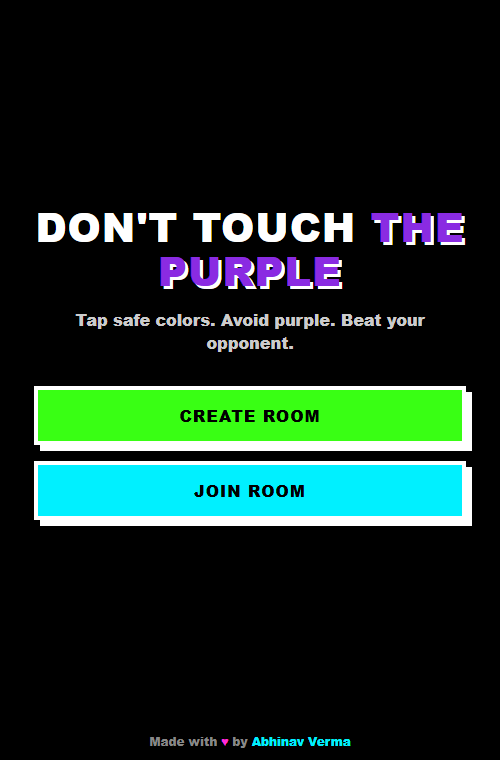
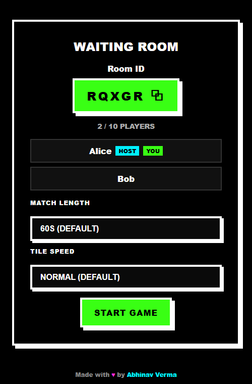
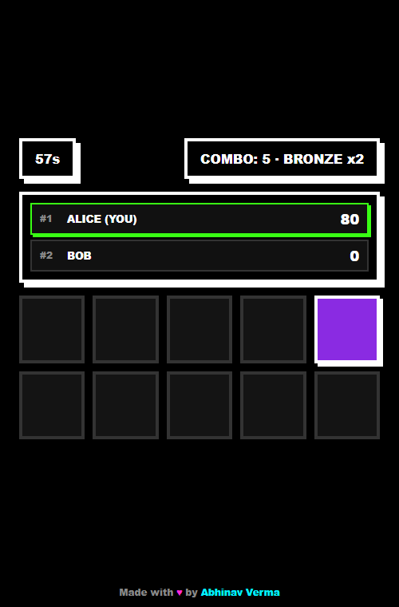

# 🟣 Don't Touch The Purple

**A real-time multiplayer reflex game built with Angular, Node.js, and Socket.io — supporting up to 10 concurrent players in a single room.**


One tile lights up at a time on a 2×5 grid. Tap it to score — unless it's purple. Every player in the room sees the exact same tile light up at the exact same moment, and the leaderboard updates live as scores change.

<p align="center">
  
  
  
</p>

---

## Why this project

This isn't a tutorial clone — it's a small, complete real-time system I built end-to-end: a server-authoritative game engine, a reactive signals-based Angular frontend, and a sync protocol that keeps up to 10 independent clients in lockstep, with input validation, graceful disconnect handling, and a scoring model that scales from a 2-player duel to a 10-player free-for-all without breaking.

Below is what it does, how it's built, and the real bugs I found and fixed while building it — because the debugging is usually the more interesting part.

## Gameplay

- **One lit tile at a time.** Of the 10 tiles in the grid, exactly one lights up with a color; the rest stay dark. Tap the lit tile before it moves.
- **7 safe colors, 1 danger color.** Tap a safe color to score. Tap purple and you lose points and your combo.
- **Combo multipliers.** Consecutive safe taps build a combo: Bronze (3+) = 2x, Silver (6+) = 3x, Gold (10+) = 5x points.
- **Live leaderboard.** Every player's score and combo updates in real time for everyone in the room, ranked automatically.
- **Rank-based results.** The end screen tells you exactly where you placed — "YOU STOOD 1ST!", "2ND!", "3RD!" — with standard competition ranking (ties share a rank).
- **Host-configurable matches.** The host picks match length (30–120s) and tile speed (Normal/Fast/Very Fast) before starting; everyone else just plays.
- **2–10 players per room**, joined via a short shareable room code.

## Technical highlights

- **Server-authoritative state.** The client never decides what it scored — it sends a tile index, and the server (the only one holding the real grid) looks up the color, computes the result, and broadcasts it. A modified client can't cheat.
- **Input validation against allow-lists, not trust.** Host-chosen match settings (duration, speed) are validated against a fixed set of allowed values on the server; anything out of range silently falls back to sane defaults instead of being trusted.
- **Correct N-player game-over logic.** An early implementation ended the *entire match* the instant *any single player's* score went negative — fine for 2 players, but with 6+ players tapping concurrently it killed matches in under a second. Found this with an automated multi-client test, then fixed it so the match only ends early if too few players remain to compete.
- **Signal-based reactive frontend.** Angular 22 signals and `computed()` drive the whole UI — leaderboard sorting, rank calculation, combo tier labels — with no manual change-detection wiring.
- **Responsive at scale, not just at a breakpoint.** The UI was verified with 10 simulated players at a 320×568 mobile viewport, not just visually inspected at desktop width.

### Bugs I caught before they shipped

Every one of these was found by actually running the app with simulated multiple clients (Socket.io scripts and headless multi-context Playwright), not by eyeballing the code:

| Bug | How it was found | Fix |
|---|---|---|
| Purple tiles rendered as black | CSS variable name (`--deep-purple`) didn't match what the template referenced (`--purple`) | Renamed the variable to match |
| Entire page content pinned top-left instead of centered | A routed Angular component tag defaults to `display: inline`, silently breaking the flex-centering chain | Added `display: contents` on routed component tags |
| 6-player matches ending after ~1 second | Automated 6-client test showed the match dying almost instantly | Removed the "end match if any player goes negative" rule; now only ends early if too few players remain |
| `<select>` dropdowns always showing the first option, ignoring the real default | `[value]` bound on the parent `<select>` races against its `<option>` children being created | Bound `[selected]` on each `<option>` instead |
| Footer overlapping mid-page content on long 10-player screens | `html, body { height: 100% }` gave the page a *fixed* one-viewport height, so anything after the overflowing content got stretched to a false boundary | Switched to `min-height` so the page grows to fit real content |

## Tech stack

| Layer | Technology |
|---|---|
| Frontend | Angular 22 (standalone components, signals), TypeScript |
| Backend | Node.js, Express, Socket.io |
| Real-time transport | WebSockets via Socket.io rooms |
| Styling | Hand-rolled neo-brutalist CSS (no framework) |
| Testing | Vitest (unit), Playwright (multi-client E2E verification) |
| Deployment target | Vercel (frontend), Render (backend) |

## Architecture

**Client (Angular)**
- `Home` — create/join a room
- `GameRoom` — waiting room, live grid + HUD, leaderboard, result screen
- `Socket` service — thin socket.io-client wrapper, normalizes server events into app state
- `GameState` service — signal-based single source of truth for the UI

**Server (Node + Socket.io)**
- `index.js` — Express + Socket.io wiring, the authoritative game loop
- `rooms.js` — room and player lifecycle, host tracking
- `gameSettings.js` — validates host-chosen match settings against allow-lists
- `gameLogic.js` — scoring, combo tiers, purple penalty
- `colors.js` — grid/tile generation

**Event flow:** `createRoom` / `joinRoom` → `startGame` → the server runs the authoritative loop, broadcasting `syncGrid` (which tile is lit) and `timerUpdate` to everyone in the room → the client sends `tapTile` with just an index → the server resolves the outcome and broadcasts `scoreUpdate` to all players → `gameOver` when the timer runs out.

The server is the only source of truth for scores, the grid, and the timer. The client never computes a score — it sends an index and renders whatever the server says happened.

## Getting started

### Prerequisites

- Node.js 20.19+ (developed and tested on Node 24)
- npm

### Run the backend

```bash
cd server
npm install
npm start          # listens on http://localhost:3000
```

### Run the frontend

```bash
cd client
npm install
npm start           # serves on http://localhost:4200
```

Open `http://localhost:4200` in two or more browser tabs/devices to play against yourself locally — create a room in one tab, join it with the room code in the others.

## Testing

```bash
cd client
npm test            # unit tests (Vitest, via Angular's test runner)
```

The multiplayer sync logic, scoring, combo tiers, and layout at scale were additionally verified with scripted multi-client tests (Socket.io clients and headless multi-context Playwright sessions simulating 2–10 concurrent players) during development — the bug table above is a direct result of that process.

## Project structure

```
client/src/app/
├── components/
│   ├── home/            # lobby: create/join room
│   └── game-room/        # waiting room, live game, results
├── services/
│   ├── game-state.ts     # signal-based single source of truth
│   └── socket.ts         # socket.io-client wrapper
├── models/
│   └── game.models.ts     # shared types + constants
└── utils/
    └── ordinal.ts         # 1st/2nd/3rd formatting

server/src/
├── index.js               # Express + Socket.io wiring, game loop
├── rooms.js               # room & player lifecycle
├── colors.js               # grid/tile generation
├── gameLogic.js             # scoring, combo tiers, penalties
└── gameSettings.js          # host-chosen settings, validated
```

## Deployment

**Backend → Render** (deploy this first, you'll need its URL for the frontend):
1. New **Web Service**, root directory `server/`.
2. Build command: `npm install`. Start command: `npm start`.
3. Once deployed, note the Render URL (e.g. `https://donttouchpurple-server.onrender.com`).

**Frontend → Vercel**:
1. Before building, set `serverUrl` in `client/src/environments/environment.prod.ts` to the Render URL from above.
2. New Vercel project, root directory `client/`. A `vercel.json` is already checked in — it points Vercel at Angular's actual build output (`dist/dont-touch-purple-client/browser`) and adds the SPA rewrite rule client-side routes like `/room/ABCDE` need to survive a page refresh.
3. Deploy, then note the Vercel URL.

**Close the loop:** back on Render, set the `CLIENT_ORIGIN` environment variable to the Vercel URL (e.g. `https://donttouchpurple.vercel.app`) and redeploy, so CORS is locked to your actual frontend instead of the `*` wildcard default.

## Roadmap

- Spectator mode for rooms that are full
- Match history / persistent stats per player
- Custom lobby themes

---

Built by **Abhinav Verma** — [LinkedIn](https://in.linkedin.com/in/abhinavverma2) · [GitHub](https://github.com/abhinavverma007/donttouchpurple)
